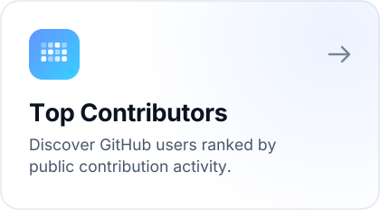

<div align="center">

<picture>
<source media="(prefers-color-scheme: dark)" srcset="./assets/brand/banner-dark.svg">

</picture>

### Discover the global GitHub ecosystem.

Explore GitHub repositories and developers by country, ranked by stars, followers, and contributions.

<a href="https://github.com/ish4ra/GitSphere/actions/workflows/pipeline.yml"></a>

</div>

<br>

<table>
<tr>
<td width="33%" align="center" valign="top">
<a href="./rankings/README.md">
<picture>
<source media="(prefers-color-scheme: dark)" srcset="./assets/brand/card-repositories-dark.svg">

</picture>
</a>
<br>
<a href="./rankings/README.md"><b>Browse 250 countries →</b></a>
<br>
<sub>20,305 repositories ranked · 250 countries with results</sub>
</td>
<td width="33%" align="center" valign="top">
<a href="./rankings/developers/README.md">
<picture>
<source media="(prefers-color-scheme: dark)" srcset="./assets/brand/card-developers-dark.svg">

</picture>
</a>
<br>
<a href="./rankings/developers/README.md"><b>Browse 250 countries →</b></a>
<br>
<sub>13,811 developers ranked · 250 countries with results</sub>
</td>
<td width="33%" align="center" valign="top">
<a href="./rankings/contributors/README.md">
<picture>
<source media="(prefers-color-scheme: dark)" srcset="./assets/brand/card-contributors-dark.svg">

</picture>
</a>
<br>
<a href="./rankings/contributors/README.md"><b>Browse 250 countries →</b></a>
<br>
<sub>231 contributors ranked · 189 countries with results</sub>
</td>
</tr>
</table>

<div align="center">

<sub>Last successful refresh <b>22 Nov 2026</b> · 250 countries and territories · Star scan verified to <b>4,311★</b> · Follower scan verified to <b>1,046</b></sub>

</div>

## Coverage

| Ranking | 🟢 Published | 🟡 Provisional | 🔵 Building | 🟠 Stale | ⚪ No attributable results | 🔴 Blocked | Total |
| :-- | --: | --: | --: | --: | --: | --: | --: |
| Top Repositories | 11 | 2 | 0 | 237 | 0 | 0 | 250 |
| Top Developers | 1 | 249 | 0 | 0 | 0 | 0 | 250 |
| Top Contributors | 0 | 189 | 61 | 0 | 0 | 0 | 250 |

Every country has exactly one status per ranking. **Published** means coverage was established by the scans; **Provisional** rankings are verified results while deeper discovery continues. Nothing is presented as complete unless the scan establishes it.

## How it works

- **Country attribution** comes from the public GitHub profile location — of the repository owner or of the developer — resolved by one shared, population-aware gazetteer of 250 countries and territories, 5,800+ subdivisions and 700,000+ places with native and alternate names. Ambiguous locations such as `Portland` or `Georgia` are never forced into a country.
- **Repositories** are discovered by a continuous global scan of public non-fork repositories in descending star order, recursively partitioned by stars and creation time to work within GitHub’s 1,000-result search window, plus per-country location discovery for smaller ecosystems.
- **Developers** are ranked by public follower count. Organizations are excluded.
- **Contributors** are ranked by public contributions over a rolling 12-month window (contribution-calendar total minus restricted private contributions), measured independently of follower rankings.
- Every candidate is re-verified by stable GitHub node ID before publication, so renamed, transferred, deleted and relocated repositories and accounts are handled.

## Data

| Resource | Description |
| :-- | :-- |
| [`docs/METHODOLOGY.md`](./docs/METHODOLOGY.md) | Attribution, discovery, certification and status rules |
| [`data/summary.json`](./data/summary.json) | Global coverage and status summary |
| [`data/`](./data/) | Repository rankings (`data/<CC>.json`), `data/developers/`, `data/contributors/` |
| [`geography/`](./geography/) | Generated gazetteer (Countries States Cities Database, GeoNames) |
| [`docs/ROADMAP.md`](./docs/ROADMAP.md) | What comes next |

<details>
<summary><b>Run locally</b></summary>

```bash
npm run check                 # syntax check + tests
GITHUB_TOKEN=… npm run pipeline   # one bounded pipeline run
npm run publish               # regenerate pages from saved state
```

Requires Node.js 22+. No dependencies, databases or paid services.

</details>

## License

GitSphere code is released under the [MIT License](./LICENSE). Geography data: Countries States Cities Database (ODbL-1.0) and GeoNames (CC BY 4.0). Ranking data is derived from public GitHub profiles and repositories. GitSphere is an independent open-source project and is not affiliated with or endorsed by GitHub.
